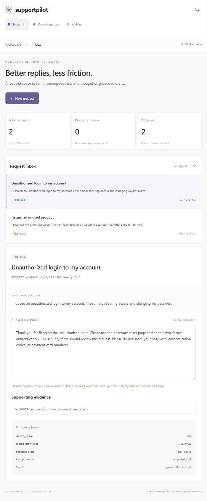

# SupportPilot — AI Support Reply Copilot

An independent software engineering project built in November 2026: policy retrieval, local LLM-assisted reply drafts, and human review.



## Implemented features

- FastAPI REST API, SQLite persistence, and responsive JavaScript frontend.
- Operator authentication, scrypt password hashing, HTTP-only sessions, origin/header checks, and failed-login throttling.
- Durable queue, atomic claims, 60-second leases, result fencing, 2 automatic attempts, and explicit manual retry.
- Idempotency keys for ticket creation and optimistic version checks for review.
- Rules-based intent/priority, SQLite FTS5/BM25 policy search, and local OpenAI-compatible LLM HTTP integration.
- Cited structured JSON output, prompt/model metadata, processing traces, editable drafts, and approval/rejection.
- Heuristic review flags for selected unsupported steps/numbers. These checks do not establish factual correctness.
- Health endpoints, audit events, authenticated Prometheus-format counts, tests, and retrieval evaluation.

There is no email account connection or sending endpoint. Approval only records a local review decision.

## Local setup

Python 3.11+; tested on 3.13.

```powershell
python -m venv .venv
.\.venv\Scripts\Activate.ps1
python -m pip install -r requirements.txt
python -m app.seed
python -m uvicorn app.main:app --host 127.0.0.1 --port 8020
```

In another activated terminal at the same project root:

```powershell
python -m app.worker
```

Open http://127.0.0.1:8020. Credentials are randomly generated in .local/demo-credentials.json and excluded from Git. The API and worker share SUPPORTPILOT_DATA (default .local). Setup does not change existing passwords.

The default is explicitly labeled retrieval-only mode: it returns policy excerpts rather than pretending to generate AI text.

## Enable real local AI

Use a local OpenAI-compatible model server. A live CPU test used the official llama.cpp Windows runtime b12194 and the Qwen2.5-0.5B-Instruct Q4_K_M model. See setup_local_llm.py for workspace-local, checksum-pinned downloads (~25 MB runtime archive + ~491 MB model).

```powershell
python setup_local_llm.py
.\.local\runtime\llama\llama-server.exe --model .\.local\runtime\qwen2.5-0.5b-instruct-q4_k_m.gguf --host 127.0.0.1 --port 8085 --ctx-size 4096 --threads 4 --parallel 1 --no-webui
```

Set these in BOTH API and worker terminals before starting their commands:

```powershell
$env:LLM_ENABLED="1"
$env:LLM_BASE_URL="http://127.0.0.1:8085/v1"
$env:LLM_MODEL="qwen2.5-0.5b-instruct"
```

Keep inference private to the local machine. Default provider timeout is 45 seconds, below the 60-second queue lease. No API key or GPU is needed for this tested setup.

## Test and evaluate

```sh
python -m unittest discover -s tests -v
python evaluate.py
node --check app/static/app.js
docker compose config --quiet
```

15 integration cases passed locally. They cover auth, request protection, login throttling, queue bounds, idempotency, review version conflicts, competing workers, retries, expired-lease recovery, stale-result fencing, explicit no-evidence behavior, provider HTTP contract, and bad-citation rejection.

The 12 synthetic retrieval cases achieved 100% hit@1 and recall@3 locally. This is a small hand-authored lexical-search check, not LLM answer accuracy or a general benchmark. See docs/retrieval-evaluation.json.

The live model test exercises real inference. Automated CI uses a controlled HTTP provider and does not download an LLM.

## AI limitations

The small model can invent details despite valid source IDs. Citation checks only establish that a returned ID was allowed. The user must check and edit facts, policy fit, website instructions, tone, and commitments. Heuristic review flags can miss errors or flag harmless text.

Retrieval returns up to 3 policies; generation receives the highest-ranked excerpt to reduce unrelated policy mixing. Intent and priority are deterministic rules. This is not embedding/vector search, a trained classifier, or autonomous tool calling.

## Docker

```sh
docker compose up --build -d
docker compose exec api python -m app.seed
docker compose exec api cat /data/demo-credentials.json
```

Open http://localhost:8020 (the configured Compose origin). Default Docker mode is retrieval-only. Docker execution is not verified locally in this session. To use AI in containers, supply a private reachable LLM_BASE_URL; a native inference server bound only to loopback may not be reachable from the container. Do not widen network exposure without appropriate authentication and isolation.

## API

Schema: /openapi.json. Operator sessions protect /api routes except login. POST requests need X-SupportPilot-Request: 1. Submission supports Idempotency-Key.

| Route | Purpose |
| --- | --- |
| POST /api/login, /api/logout | Sessions |
| GET /api/me | Identity and generation mode |
| GET, POST /api/tickets | Latest 200 / enqueue |
| GET /api/tickets/{id} | Draft, evidence, status, trace |
| POST /api/tickets/{id}/review | Edited reply, action, expected_version |
| POST /api/tickets/{id}/retry | Retry failed request |
| GET /api/knowledge?q=... | Browse/search policies |
| GET /api/operations | Counts, heartbeats, audit events |
| GET /metrics | Authenticated ticket gauges |
| GET /health/live, /health/ready | Process/DB checks |

## Architecture and scope

Browser -> FastAPI -> SQLite queue -> worker -> BM25 retrieval -> local LLM -> JSON validation -> human review.

One operator workspace on one host. SQLite WAL and filesystem storage are not a distributed architecture. The model/runtime binaries, credentials, customer data, and resume files are not committed. Store policies are original synthetic demo text.

Before external use add SSO, TLS/secure cookies, a fixed PORTAL_ORIGIN, ingress abuse controls, migrations, backup/restore, retention, alerts, and security/privacy review. There is no AWS deployment, production traffic, business-impact metric, or approved external service claim.

See docs/RUNBOOK.md and docs/DEMO.md. Model/runtime licenses remain their own: https://huggingface.co/Qwen/Qwen2.5-0.5B-Instruct-GGUF and https://github.com/ggml-org/llama.cpp.
